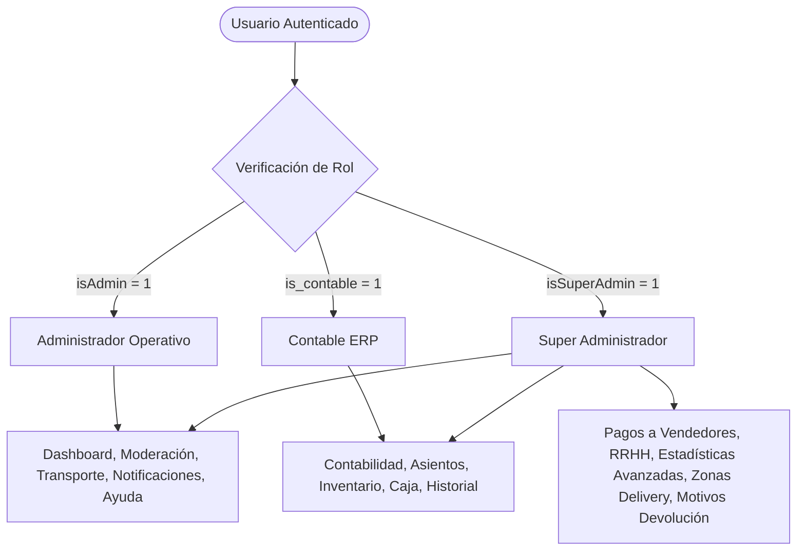
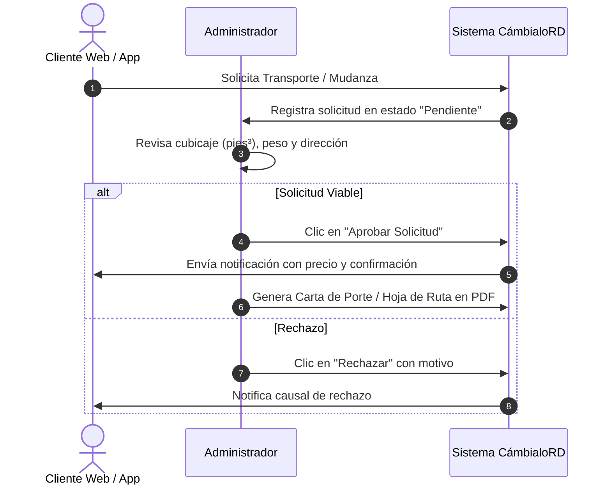

# Manual Oficial de Administración y Operaciones — CámbialoRD

**Versión del Sistema:** 1.0 (Producción)  
**Audiencia:** Administradores, Contables y Super Administradores  
**Acceso Web:** `/admin`

---

## Tabla de Contenidos
1. [Arquitectura de Roles y Accesos](#1-arquitectura-de-roles-y-accesos)
2. [Estructura del Menú y Navegación](#2-estructura-del-menú-y-navegación)
3. [Módulo 1: Dashboard de Operaciones (Principal)](#3-módulo-1-dashboard-de-operaciones-principal)
   - 3.1 Pestaña Compras
   - 3.2 Pestaña Ventas
   - 3.3 Pestaña Intercambios
   - 3.4 Pestaña Precio por Ruta de Envío
   - 3.5 Pestaña Trabajo y Envíos (Intercambios Confirmados)
4. [Módulo 2: Detalle y Gestión de Órdenes (Compras, Ventas e Intercambios)](#4-módulo-2-detalle-y-gestión-de-órdenes)
   - 4.1 Detalle de Orden de Compra (`/admin/compras/{id}`)
   - 4.2 Detalle de Venta (`/admin/ventas/{id}`)
   - 4.3 Detalle de Intercambio (`/admin/intercambios/{id}`)
   - 4.4 Facturas y Comprobantes en PDF
5. [Módulo 3: Logística y Transporte Pesado (`/admin/erp/transporte`)](#5-módulo-3-logística-y-transporte-pesado)
   - 5.1 Gestión de Solicitudes de Flete y Mudanza
   - 5.2 Catálogo de Artículos y Cubicación
   - 5.3 Flota de Camiones
   - 5.4 Parámetros y Tarifas Globales de Transporte
6. [Módulo 4: Centro de Aprobaciones y Moderación (`/admin/imagenes`)](#6-módulo-4-centro-de-aprobaciones-y-moderación)
   - 6.1 Imágenes de Artículos
   - 6.2 Fotos de Perfil
   - 6.3 Aprobación de Productos Comerciales
7. [Módulo 5: Sistema ERP Empresarial](#7-módulo-5-sistema-erp-empresarial)
   - 7.1 Contabilidad y Catálogo de Cuentas (`/admin/erp/contabilidad`)
   - 7.2 Asientos de Diario y Libro Mayor
   - 7.3 Reportes Financieros en PDF (Balance General y Estado de Resultados)
   - 7.4 Control de Inventario y Kardex (`/admin/erp/inventario`)
   - 7.5 Cuadre y Arqueo de Caja (`/admin/erp/caja`)
   - 7.6 Historial Consolidado de Transacciones (`/admin/erp/historial`)
8. [Módulo 6: Pagos a Vendedores y Billetera (`/admin/pagos-vendedores`)](#8-módulo-6-pagos-a-vendedores-y-billetera)
9. [Módulo 7: Recursos Humanos y Vacantes (`/admin/recursos-humanos`)](#9-módulo-7-recursos-humanos-y-vacantes)
10. [Módulo 8: Centro de Ayuda y Tutoriales (`/admin/ayuda`)](#10-módulo-8-centro-de-ayuda-y-tutoriales)
11. [Módulo 9: Centro de Notificaciones](#11-módulo-9-centro-de-notificaciones)
    - 11.1 Notificaciones Directas (`/admin/notificaciones`)
    - 11.2 Notificaciones por Categoría (`/admin/notificaciones/categorias`)
12. [Módulo 10: Configuración Logística y Zonas de Delivery (`/admin/delivery/zonas`)](#12-módulo-10-configuración-logística-y-zonas-de-delivery)
13. [Módulo 11: Business Intelligence y Estadísticas (`/admin/estadisticas`)](#13-módulo-11-business-intelligence-y-estadísticas)
14. [Módulo 12: Configuración del Sistema y Motivos de Devolución](#14-módulo-12-configuración-del-sistema-y-motivos-de-devolución)

---

## 1. Arquitectura de Roles y Accesos

El panel cuenta con tres niveles de privilegios estrictos:



| Rol | Campo BD | Responsabilidad Principal |
|---|---|---|
| **Administrador** | `isAdmin = 1` | Control diario de pedidos, moderación de imágenes y productos, logística de transporte y soporte. |
| **Contable** | `is_contable = 1` | Registros contables, catálogo de cuentas, arqueo de caja, auditoría de inventario y balances financieros. |
| **Super Administrador** | `isSuperAdmin = 1` | Control total, liquidación y pago a vendedores, contrataciones (RRHH), BI y configuración financiera. |

---

## 2. Estructura del Menú y Navegación

### Vista Esquemática del Sidebar de Navegación

```
┌──────────────────────────────────────────────┐
│  [ CÁMBIALORD LOGO ]                         │
├──────────────────────────────────────────────┤
│  PRINCIPAL                                   │
│  [🏠] Dashboard                              │
│  [🚚] Transporte                             │
│  [🖼️] Centro de Aprobaciones                 │
├──────────────────────────────────────────────┤
│  ERP EMPRESARIAL (SuperAdmin / Contable)     │
│  [📄] Contabilidad                           │
│  [📦] Inventario                             │
│  [💵] Cuadre de Caja                         │
│  [🕒] Ventas e Intercambios                  │
├──────────────────────────────────────────────┤
│  ADMINISTRACIÓN                              │
│  [👥] Recursos Humanos (SuperAdmin)          │
│  [💬] Mensajes Predefinidos                  │
│  [❓] Páginas de Ayuda                       │
│  [🔔] Notificaciones                         │
│  [📋] Notificar Categorías                   │
├──────────────────────────────────────────────┤
│  REPORTES Y CONFIGURACIÓN (SuperAdmin)       │
│  [💳] Pagos a Vendedores                     │
│  [📈] Estadísticas                           │
│  [📍] Zonas de Envío                         │
│  [↩️] Motivos Devolución                     │
├──────────────────────────────────────────────┤
│  [👤] Isidro Pérez (Admin)                   │
│  [🚪] Cerrar Sesión                          │
└──────────────────────────────────────────────┘
```

---

## 3. Módulo 1: Dashboard de Operaciones (Principal)
**Ruta:** `/admin`

### Interfaz del Dashboard

```
┌─────────────────────────────────────────────────────────────────────────────┐
│ 🏠 Resumen de Operaciones                                                   │
│ Monitorea en tiempo real tus compras, ventas e intercambios.                │
├─────────────────────────────────────────────────────────────────────────────┤
│ [ COMPRAS: 124 ]  [ VENTAS: 98 ]  [ INTERCAMBIOS: 45 ]                      │
├─────────────────────────────────────────────────────────────────────────────┤
│  [ Compras (124) ] [ Ventas (98) ] [ Intercambios (45) ] [ Precio Envíos ] │
├─────────────────────────────────────────────────────────────────────────────┤
│  Filtros: [ Buscar... ] [ Estado: Todos ▼ ] [ Provincia ▼ ] [ Municipio ▼ ] │
├─────────────────────────────────────────────────────────────────────────────┤
│  ID   │ Fecha      │ Comprador       │ Total     │ Estatus   │ Acciones     │
│───────┼────────────┼─────────────────┼───────────┼───────────┼──────────────│
│  #102 │ 12/10/2026 │ Juan Pérez      │ RD$ 3,500 │ Aprobado  │ [👁️ Ver]    │
│  #101 │ 11/10/2026 │ María Gómez     │ RD$ 1,200 │ Pendiente │ [👁️ Ver]    │
└─────────────────────────────────────────────────────────────────────────────┘
```

### 3.1 Pestaña "Compras"
* **Propósito:** Supervisar las compras directas realizadas por los clientes en la tienda.
* **Columnas:** ID de Pago, Fecha, Datos del Comprador, Monto Total, Estado del Pedido y Acciones.
* **Pasos para filtrar:**
  1. Escribe en el buscador el nombre, correo o ID del pedido.
  2. Selecciona el estado en el menú desplegable (`pendiente`, `aprobado`, `enviado`, `entregado`, `cancelado`).
  3. Haz clic en **Filtrar** para refrescar la tabla.

### 3.2 Pestaña "Ventas"
* **Propósito:** Visualizar la contraparte de cada compra desde la perspectiva del vendedor.
* **Funciones:** Permite auditar qué vendedor realizó la venta, comisión retenida por la plataforma y saldo a transferir.

### 3.3 Pestaña "Intercambios"
* **Propósito:** Gestionar el núcleo de la plataforma: las negociaciones de trueque entre dos usuarios.
* **Estados posibles:** `Inicial`, `pendiente`, `contraoferta`, `aceptado`, `completado`, `rechazado`, `cancelado`.

### 3.4 Pestaña "Precio por ruta de envío"
* **Propósito:** Consultar la matriz de costos logísticos calculada para los orígenes y destinos seleccionados.

### 3.5 Pestaña "Trabajo y Envíos (Intercambios Confirmados)"
* **Propósito:** Lista operativa exclusiva para el equipo logístico. Muestra los trueques donde ambas partes ya aceptaron y se requiere coordinar la recogida y entrega de ambos paquetes.

---

## 4. Módulo 2: Detalle y Gestión de Órdenes

### 4.1 Detalle de Orden de Compra (`/admin/compras/{id}`)

```
┌─────────────────────────────────────────────────────────────────────────────┐
│ ⬅️ Volver a compras                       ORDEN #102 [ APROBADO ]           │
├─────────────────────────────────────────────────────────────────────────────┤
│ 👤 DATOS DEL COMPRADOR         │ 📦 RESUMEN DEL PEDIDO                      │
│ Nombre: Juan Pérez             │ Producto: Smartphone Samsung A54          │
│ Correo: juan@correo.com        │ Cantidad: 1                                │
│ Teléfono: (809) 555-0199       │ Precio Unitario: RD$ 3,000.00             │
│ Dirección: C/ Central #12, DN  │ Costo de Envío:  RD$   500.00             │
│                                │ TOTAL PAGADO:    RD$ 3,500.00             │
├─────────────────────────────────────────────────────────────────────────────┤
│ 🔄 ACTUALIZAR ESTADO DE LA ORDEN                                            │
│ Seleccionar Estado: [ Enviado             ▼ ]  [ Guardar Estado ]           │
├─────────────────────────────────────────────────────────────────────────────┤
│ 🚚 GESTIÓN DE RASTREO / TRACKING                                            │
│ Empresa / Courier:  [ Metro Pac                     ]                       │
│ Código de Rastreo:  [ MP-99823412                   ]                       │
│ URL de Seguimiento: [ https://metropac.com.do/track ]                       │
│ [ 📤 Enviar Tracking al Cliente ]                                           │
├─────────────────────────────────────────────────────────────────────────────┤
│ 📄 ACCIONES: [ 🖨️ Imprimir / Descargar PDF ]                                │
└─────────────────────────────────────────────────────────────────────────────┘
```

#### Paso a Paso: Actualizar Estado y Enviar Guía de Rastreo
1. **Entrar al Detalle:** Haz clic en el botón `[👁️ Ver]` en la tabla del dashboard.
2. **Cambiar Estado:**
   - En la sección **Actualizar Estado**, despliega el selector.
   - Flujo habitual: `Pendiente` ➔ `Aprobado` ➔ `Enviado` ➔ `Entregado`.
   - Haz clic en **Guardar Estado**. El sistema enviará una notificación automática al comprador.
3. **Cargar Información de Envío:**
   - Escribe el código de guía en **Código de Rastreo**.
   - Coloca el enlace directo de la empresa de mensajería en **URL de Seguimiento**.
   - Haz clic en **Enviar Tracking al Cliente**.

---

## 5. Módulo 3: Logística y Transporte Pesado
**Ruta:** `/admin/erp/transporte`

Este módulo gestiona solicitudes de flete, mudanzas, cubicaje y flota de camiones en República Dominicana.



### Pestañas del Módulo de Transporte:
1. **Solicitudes:** Listado de fletes solicitados con origen, destino, artículos y estado (`Pendiente`, `Aprobado`, `Rechazado`, `Completado`).
2. **Catálogo de Artículos:** Dimensiones estándar (largo, ancho, alto), peso y cubicaje para muebles, electrodomésticos y cajas.
3. **Flota de Camiones:** Registro de vehículos (Placa, Chofer, Capacidad en pies cúbicos, Toneladas máximas).
4. **Configuración Tarifaria:**
   - Precio por kilómetro de transporte (RD$).
   - Precio por kilómetro de mudanza (RD$).
   - Tarifa camión pequeño / mediano / grande.
   - Tarifa por ayudante/persona de carga.

---

## 6. Módulo 4: Centro de Aprobaciones y Moderación
**Ruta:** `/admin/imagenes`

Garantiza la seguridad y calidad visual del catálogo antes de que las imágenes se publiquen.

```
┌─────────────────────────────────────────────────────────────────────────────┐
│ 🖼️ Centro de Moderación y Aprobaciones                                      │
├─────────────────────────────────────────────────────────────────────────────┤
│  [ Pestaña: Artículos (12) ]  [ Fotos Perfil (4) ]  [ Nuevos Productos (3) ]│
├─────────────────────────────────────────────────────────────────────────────┤
│  ┌───────────────────────┐   ┌───────────────────────┐                      │
│  │   [ FOTO ARTÍCULO ]   │   │   [ FOTO ARTÍCULO ]   │                      │
│  │ Ítem: Laptop Dell     │   │ Ítem: Bicicleta MTB   │                      │
│  │ Usuario: Pedro M.     │   │ Usuario: Ana R.       │                      │
│  │                       │   │                       │                      │
│  │ [✓ Aprobar] [✗ Rech]  │   │ [✓ Aprobar] [✗ Rech]  │                      │
│  └───────────────────────┘   └───────────────────────┘                      │
│                                                                             │
│  [ ✓ Aprobar Todas las Imágenes Pendientes ]                                │
└─────────────────────────────────────────────────────────────────────────────┘
```

### Paso a Paso para Moderar:
1. **Aprobar Individualmente:** Haz clic en el botón verde `✓ Aprobar`. La imagen se hace pública al instante.
2. **Rechazar con Justificación:**
   - Haz clic en `✗ Rechazar`.
   - Se abrirá un modal solicitando el **Motivo de Rechazo** (ej: *"Imagen borrosa"*, *"Contenido prohibido"*, *"Marca de agua de terceros"*).
   - Haz clic en **Confirmar Rechazo**. El usuario recibirá una notificación explicando el motivo.
3. **Aprobación Masiva:** Si se verificó un lote completo, pulsa **✓ Aprobar Todas**.

---

## 7. Módulo 5: Sistema ERP Empresarial
**Rutas:** `/admin/erp/*`

### 7.1 Contabilidad y Catálogo de Cuentas (`/admin/erp/contabilidad`)
* **Catálogo Jerárquico:** Clasificación formal en Activo (1), Pasivo (2), Capital (3), Ingresos (4), Costos (5) y Gastos (6).
* **Crear Nueva Cuenta:**
  1. Haz clic en `+ Nueva Cuenta`.
  2. Ingresa Código (ej: `1101-01`), Nombre (`Caja General`), Tipo (`Activo`), Nivel (`2`) y Cuenta Padre.
  3. Marca `Permite Movimiento` si recibirá asientos directos.
* **Asientos de Diario:**
  - Registro de transacciones con partida doble.
  - Validación obligatoria: La suma del **Debe** debe ser exactamente igual a la suma del **Haber**.
* **Libro Mayor:** Muestra el historial cronológico y saldo acumulado cuenta por cuenta.
* **Reportes Financieros:** Generación automática de Balance General, Balanza de Comprobación y Estado de Resultados descargables en PDF oficial.

### 7.2 Cuadre y Arqueo de Caja (`/admin/erp/caja`)

```
┌─────────────────────────────────────────────────────────────────────────────┐
│ 💵 Cuadre de Caja — [ PERÍODO ACTIVO 🟢 ]              [ 🔒 Realizar Arqueo ]│
├─────────────────────────────────────────────────────────────────────────────┤
│  Ventas Tarjeta:     RD$ 45,200.00  │  Ingresos Flete:    RD$  8,400.00     │
│  Comisiones Trueque: RD$  3,100.00  │  TOTAL RECAUDADO:   RD$ 56,700.00     │
├─────────────────────────────────────────────────────────────────────────────┤
│  Últimas Transacciones Registradas en el Turno:                             │
│  • 14:32 - Pago Tarjeta Orden #102 - RD$ 3,500.00 [Aprobado]                │
│  • 15:10 - Pago Flete Transporte #44 - RD$ 1,800.00 [Aprobado]              │
└─────────────────────────────────────────────────────────────────────────────┘
```

#### Paso a Paso para Cerrar Turno / Arqueo:
1. Haz clic en el botón superior derecho **Realizar Arqueo**.
2. Ingresa los montos físicos contados y observaciones de cierre.
3. Confirma el cierre. El sistema generará el asiento contable automático y congelará el período.

### 7.3 Control de Inventario y Kardex (`/admin/erp/inventario`)
* Control de existencias físicas en el **Almacén Central**.
* Filtros por producto, categoría y tipo.
* Registro de **Entradas, Salidas y Ajustes** en el Kardex con trazabilidad del usuario responsable.

---

## 8. Módulo 6: Pagos a Vendedores y Billetera
**Ruta:** `/admin/pagos-vendedores`

Supervisa y procesa las transferencias bancarias de liquidación a los vendedores que han vendido productos y solicitado el retiro de sus ganancias.

```
┌─────────────────────────────────────────────────────────────────────────────┐
│ 💳 Solicitudes de Retiro de Fondos de Vendedores                            │
├─────────────────────────────────────────────────────────────────────────────┤
│ ID  │ Vendedor       │ Banco / Cuenta          │ Monto      │ Estado │ Acc. │
├─────┼────────────────┼─────────────────────────┼────────────┼────────┼──────┤
│ #42 │ Carlos Rosario │ Banreservas - 960124*** │ RD$ 12,500 │ Pend.  │ [Pagar]
└─────────────────────────────────────────────────────────────────────────────┘
```

### Paso a Paso para Liquidar un Retiro:
1. Revisa la cuenta bancaria de destino y el saldo acumulado del vendedor.
2. Realiza la transferencia desde la cuenta bancaria corporativa de CámbialoRD.
3. En el panel, haz clic en **[ Pagar ]**:
   - Sube la imagen del comprobante bancario emitido por el banco.
   - Ingresa el número de referencia en el campo **Notas**.
   - Haz clic en **Confirmar Pago**.
4. El sistema actualizará el estado a `Pagado`, descontará el balance de la billetera del vendedor y le enviará un mensaje con el comprobante.

---

## 9. Módulo 7: Recursos Humanos y Vacantes
**Ruta:** `/admin/recursos-humanos`

Permite publicar puestos de trabajo y vacantes activas en la plataforma:
* **Crear Vacante:** Título del puesto, Departamento, Descripción de funciones, Requisitos y salario opcional.
* **Activar / Pausar:** Toggle para mostrar u ocultar la oferta del portal público sin borrarla.

---

## 10. Módulo 8: Centro de Ayuda y Tutoriales
**Ruta:** `/admin/ayuda`

CMS integrado para mantener actualizados los 3 tutoriales interactivos clave:
1. **¿Cómo realizar un intercambio?** (`/realizar-intercambio`)
2. **¿Cómo vender en CámbialoRD?** (`/como-vender`)
3. **¿Cómo comprar artículos?** (`/como-comprar`)

* **Editor de Pasos:** Permite agregar pasos numerados, títulos explicativos, textos y capturas de pantalla de la app.

---

## 11. Módulo 9: Centro de Notificaciones
**Rutas:** `/admin/notificaciones` y `/admin/notificaciones/categorias`

### 11.1 Notificación Directa
* Permite buscar a un usuario por nombre, email o cédula.
* Se selecciona el tipo (`Venta`, `Compra`, `Intercambio`, `Servicio`, `General`).
* Se redacta el mensaje y se envía tanto a la campana del usuario como a su móvil.

### 11.2 Notificación por Categoría
* Permite enviar campañas a todos los usuarios interesados en una categoría específica (ej: *Vehículos*, *Tecnología*, *Hogar*).

---

## 12. Módulo 10: Configuración Logística y Zonas de Delivery
**Ruta:** `/admin/delivery/zonas`

Permite configurar la cobertura nacional de entregas en República Dominicana:
* **Provincias y Municipios:** Switch de activación/desactivación inmediata para cada provincia y municipio (ej: Santo Domingo, Santiago, La Vega, etc.).
* **Tarifas por Tipo de Zona:**
  - *Corta*: Envíos locales intradistritales.
  - *Larga*: Envíos interurbanos entre provincias.
  - *Especial*: Zonas remotas o con acceso regulado.
* **Precios:** Configuración diferenciada para Persona Particular y Empresa, días estimados de entrega y recargos por seguro.

---

## 13. Módulo 11: Business Intelligence y Estadísticas
**Ruta:** `/admin/estadisticas`

Dashboard analítico exclusivo para Super Administradores:
* **Filtros Temporales:** Últimos 7 días, 30 días, 90 días, 1 año o rango personalizado.
* **KPIs Clave:**
  - Volumen Total Transaccionado (RD$).
  - Ganancias netas de la plataforma por comisiones.
  - Cantidad de intercambios exitosos vs. cancelados.
  - Tasa de conversión de compras e intenciones.
* **Alertas Automáticas del Sistema:**
  - Detección de pagos con tarjeta rechazados frecuentemente en 24h.
  - Usuarios con múltiples cancelaciones de trueques.
  - Publicaciones sin interacción por más de 60 días.
* **Control de ITBIS:** Switch para definir qué categorías comerciales aplican o están exentas de impuesto.

---

## 14. Módulo 12: Configuración del Sistema y Motivos de Devolución
**Ruta:** `/admin/motivos-devolucion`

* Catálogo formal de causas de disputa o devolución (ej: *"Artículo no coincide con la descripción"*, *"Desperfecto no declarado"*, *"Daño en transporte"*).
* Ayuda a estandarizar los reclamos de los compradores e intercambiadores para mediación del equipo de soporte.

---

### Resumen de Rutas de Acceso Rápido

| Módulo | Ruta URL | Nivel Mínimo |
|---|---|---|
| Dashboard Principal | `/admin` | Admin |
| Detalle de Compra | `/admin/compras/{id}` | Admin |
| Centro de Aprobaciones | `/admin/imagenes` | Admin |
| Transporte y Fletes | `/admin/erp/transporte` | Admin |
| Contabilidad General | `/admin/erp/contabilidad` | Contable |
| Cuadre de Caja | `/admin/erp/caja` | Contable |
| Inventario Central | `/admin/erp/inventario` | Contable |
| Historial Transaccional | `/admin/erp/historial` | Contable |
| Pagos a Vendedores | `/admin/pagos-vendedores` | SuperAdmin |
| Recursos Humanos | `/admin/recursos-humanos` | SuperAdmin |
| Zonas de Envío | `/admin/delivery/zonas` | SuperAdmin |
| Estadísticas y BI | `/admin/estadisticas` | SuperAdmin |
| CMS de Ayuda | `/admin/ayuda` | Admin |
| Notificaciones | `/admin/notificaciones` | Admin |
| Motivos de Devolución | `/admin/motivos-devolucion` | SuperAdmin |
